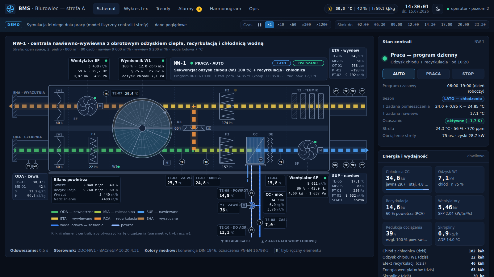
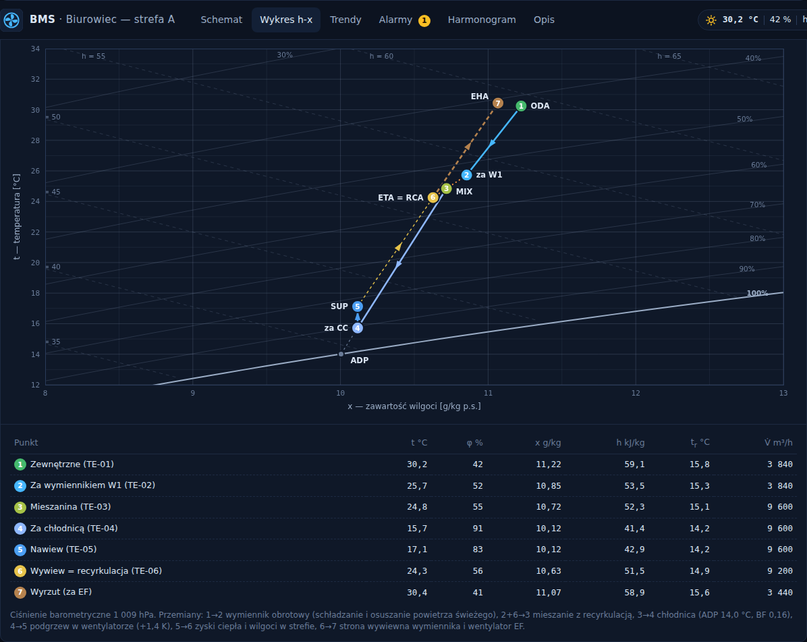
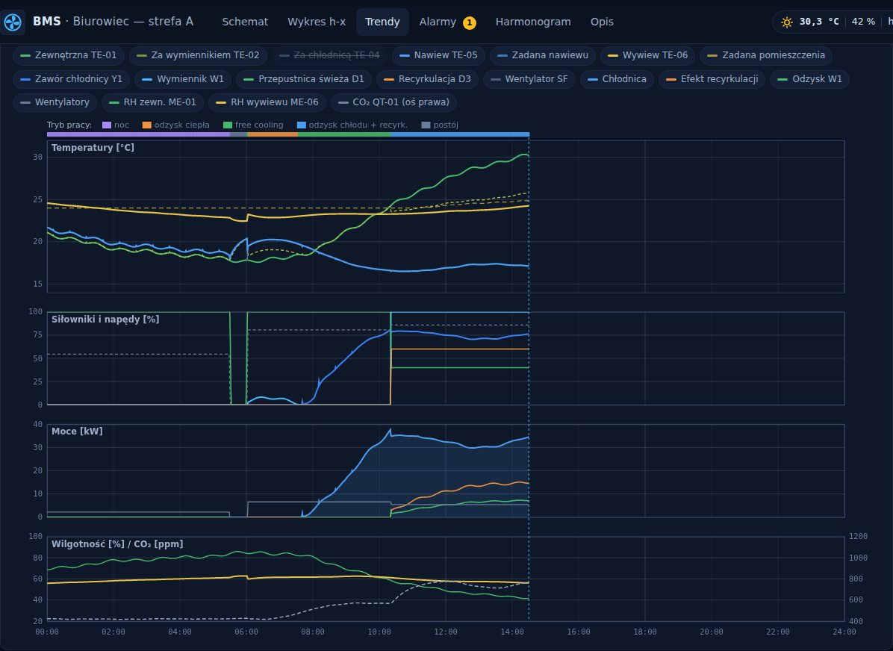

# BMS · centrala NW-1 — praca w okresie letnim

Interaktywna wizualizacja interfejsu BMS centrali nawiewno-wywiewnej z **obrotowym (sorpcyjnym) odzyskiem ciepła**, **recyrkulacją** i **chłodnicą wodną**. Wartości na ekranie pochodzą z modelu fizycznego centrali i obsługiwanej strefy, który działa w przeglądarce. Dzięki temu parametry są ze sobą spójne: temperatury, wilgotności, moce, położenia siłowników i przepływy wynikają z bilansów.

**Strona:** https://powerczuk92.github.io/firstone/



## Co jest na stronie

- **Schemat** — synoptyka centrali w kolorach mediów (ODA, SUP, ETA, EHA, RCA, MIA), animowane przepływy, wentylatory, wirnik wymiennika, przepustnice i zawór. Po kliknięciu elementu otwiera się jego karta z parametrami i trybem ręcznym.
- **Wykres h-x** — wykres Molliera z bieżącymi przemianami: wymiennik → mieszanie z recyrkulacją → chłodnica (ADP) → wentylator → strefa.
- **Trendy** — przebiegi całej doby: temperatury, siłowniki, moce, wilgotność i CO₂, pasek trybów pracy.
- **Alarmy**, **Harmonogram**, **Opis** — dziennik zdarzeń, program tygodniowy, założenia i sekwencja regulacji.
- **Panel boczny** — tryb pracy (AUTO / PRACA / STOP), nastawy zmieniane na żywo, energia i KPI.
- **Pasek symulacji** — przyspieszenie czasu (×1…×1200) i skok do wybranej pory dnia.

| Wykres h-x | Trendy dobowe |
|---|---|
|  |  |

## Parametry pracy (15.07, 14:30, dzień upalny)

| Punkt | t [°C] | φ [%] | x [g/kg] | h [kJ/kg] |
|---|---:|---:|---:|---:|
| Powietrze zewnętrzne (ODA) | 30,2 | 42 | 11,2 | 59,1 |
| Za wymiennikiem obrotowym | 25,7 | 52 | 10,9 | 53,5 |
| Mieszanina (40 % świeżego) | 24,8 | 55 | 10,7 | 52,3 |
| Za chłodnicą | 15,7 | 91 | 10,1 | 41,4 |
| Nawiew (SUP) | 17,1 | 83 | 10,1 | 42,9 |
| Wywiew / recyrkulacja (ETA) | 24,3 | 56 | 10,6 | 51,5 |

- Nawiew 9 600 m³/h, wywiew 9 200 m³/h. Powietrze świeże 3 840 m³/h, recyrkulacja 5 760 m³/h, wyrzut 3 440 m³/h.
- Wymiennik obrotowy: 100 % (12 obr/min), sprawność temperaturowa ok. 75 %, wilgotnościowa ok. 62 %, odzysk chłodu ok. 7 kW.
- Chłodnica: zawór 76 %, woda lodowa 7,0 / 14,9 °C, moc ok. 34,5 kW (jawna 29,7 kW), skropliny ok. 7 kg/h.
- Wentylatory: SF 4,6 kW (spręż ok. 1 040 Pa), EF 0,9 kW, SFP całkowite ok. 2,0 kW/(m³/s).
- Strefa: 24,3 °C / 56 %, CO₂ ok. 770 ppm. Zadana 24,0 °C plus kompensacja letnia +0,85 K.

## Sekwencja regulacji (lato)

1. **Harmonogram:** praca dzienna 06:00–19:00 w dni robocze. Chłodzenie nocne 22:00–05:30, gdy t pomieszczenia > 23 °C i t zewnętrzna < t pomieszczenia − 3 K.
2. **Kaskada temperatury:** temperatura nawiewu zależy od temperatury wywiewu (pasmo 22 → 18 °C), a powyżej temperatury zadanej człon PI obniża nawiew do 16 °C. Kompensacja letnia wynosi +0,2 K/K powyżej 26 °C (maks. +1,5 K).
3. **Free cooling ↔ odzysk chłodu:** gdy powietrze zewnętrzne jest cieplejsze od wywiewanego (lub ma wyższą entalpię), wirnik pracuje na 100 %, a udział powietrza świeżego spada do minimum 40 % (korekta PI wg CO₂ ≤ 900 ppm). Przy chłodnym powietrzu zewnętrznym centrala pracuje na 100 % powietrza świeżego, a wirnik stoi.
4. **Nawiew:** temperaturę reguluje zawór chłodnicy. Rano wymiennik odzyskuje ciepło, jeśli nawiew byłby zbyt zimny.
5. **Osuszanie:** regulator PI wilgotności bezwzględnej wywiewu (≤ 10,7 g/kg) obniża zadaną temperaturę nawiewu.

## Model obliczeniowy

- psychrometria powietrza wilgotnego (Magnus), ciśnienie 1009 hPa;
- wymiennik obrotowy: ε-NTU z wpływem prędkości wirnika i niezrównoważenia strumieni, odzysk wilgoci (rotor sorpcyjny);
- chłodnica: ε-NTU w potencjale entalpii (wężownica sucha / mokra), ADP, współczynnik obejścia, zawór stałoprocentowy;
- wentylatory: charakterystyki wentylatora i instalacji, ciepło silnika w strumieniu nawiewu;
- strefa: model 2-węzłowy (powietrze + masa budynku), bilans wilgoci i CO₂, zyski od ludzi, sprzętu, oświetlenia i słońca;
- pogoda: profil dobowy ASHRAE dla upalnego dnia w Warszawie (17,8–30,4 °C).

Nazwy obiektu i adresy są fikcyjne. Liczby mają charakter poglądowy i nie zastępują obliczeń projektowych.

## Struktura

```
index.html              strona (widoki, panel boczny, karta urządzenia)
assets/css/style.css    style, motyw ciemny i jasny
assets/js/psychro.js    psychrometria
assets/js/model.js      model centrali i strefy, regulacja, symulacja dnia
assets/js/schematic.js  synoptyka SVG i animacje
assets/js/charts.js     wykres h-x i trendy (canvas)
assets/js/app.js        logika interfejsu
```

## Uruchomienie lokalne

Strona nie wymaga budowania ani zależności. Wystarczy otworzyć `index.html` albo uruchomić serwer:

```bash
python3 -m http.server 8000
# http://localhost:8000
```

Model można też uruchomić w Node.js, np. do testów: `require('./assets/js/model.js').createSim({ start: 14.5 * 3600 })`.

## Publikacja

GitHub Pages serwuje stronę z gałęzi `gh-pages`. Workflow `.github/workflows/pages.yml` po każdym pushu na `main` kopiuje tam pliki strony.
